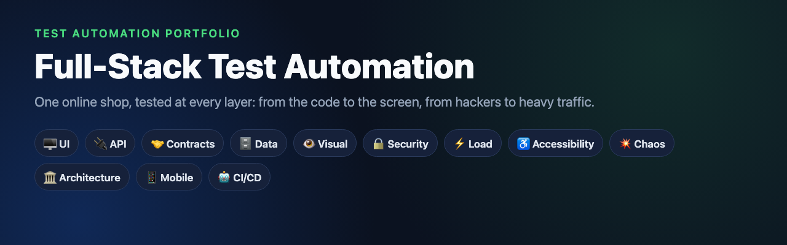
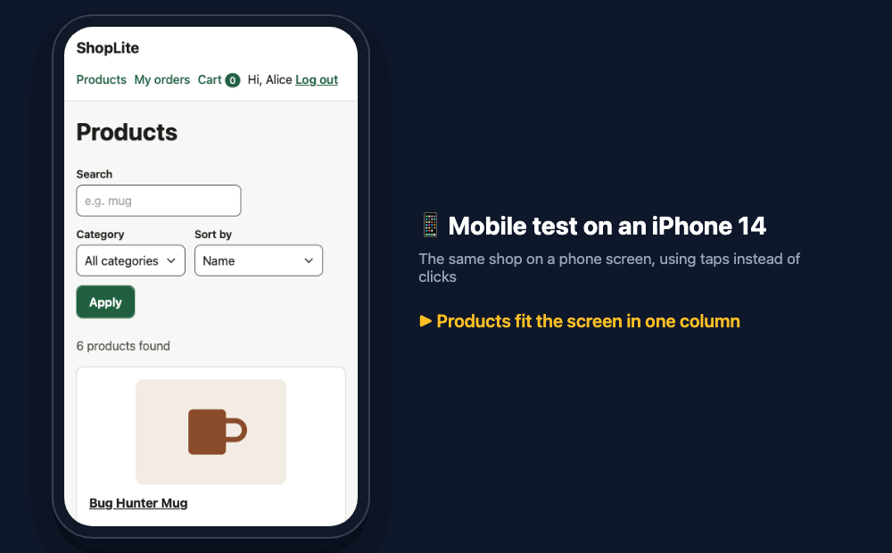
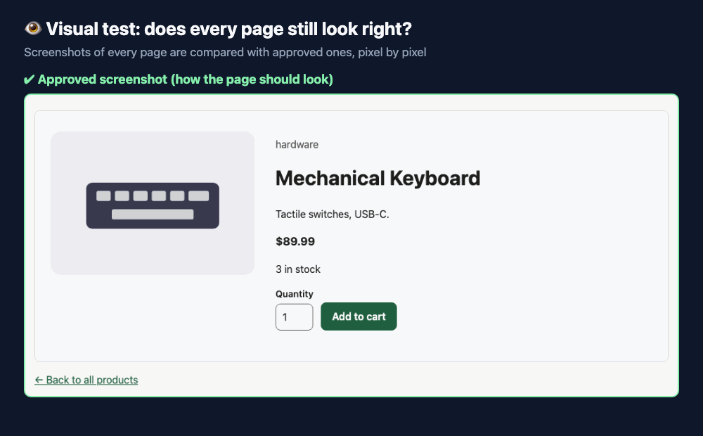
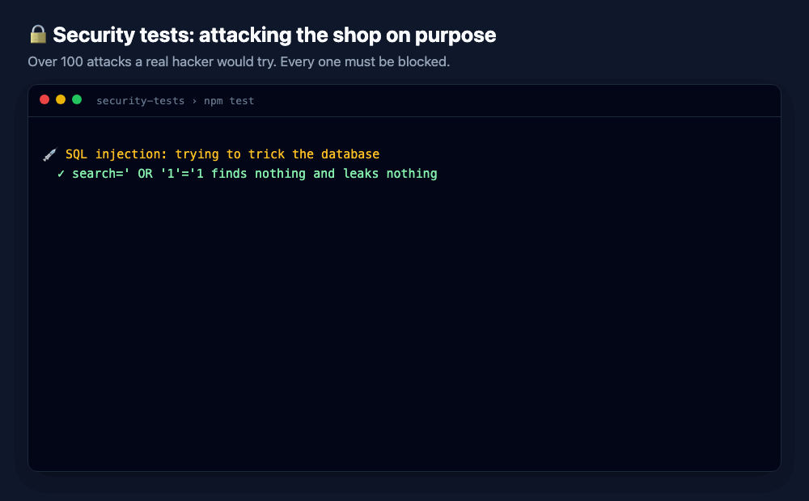
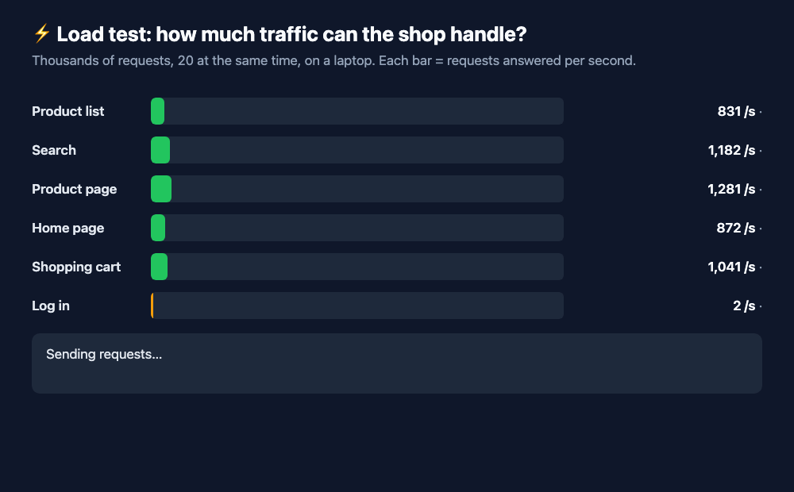
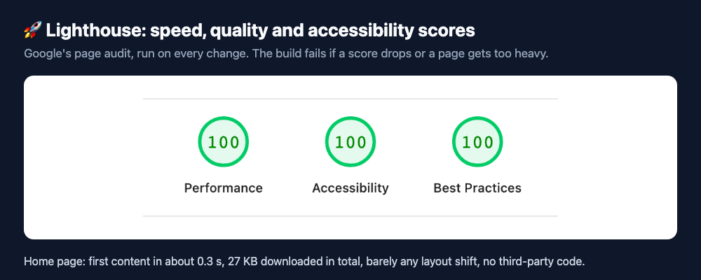
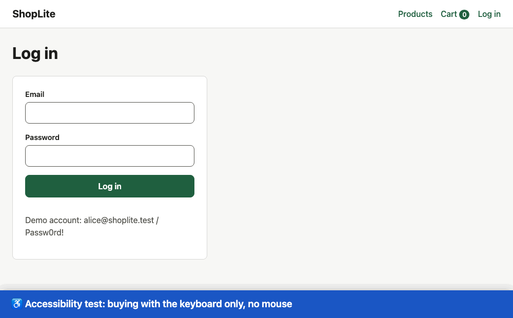
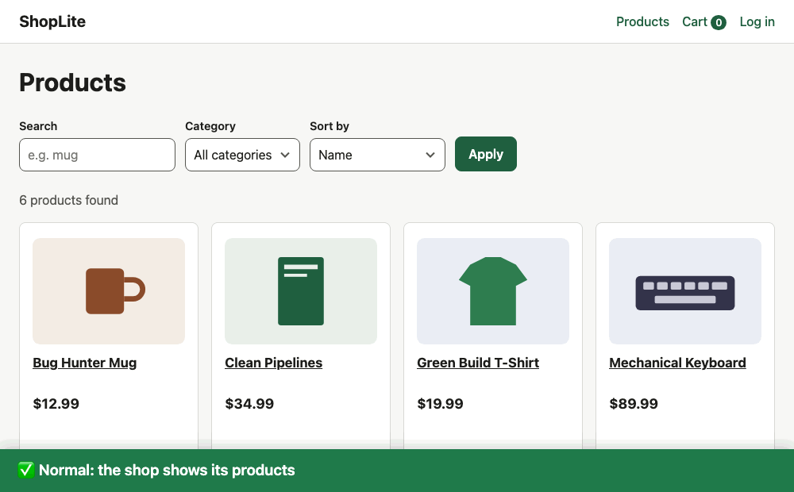
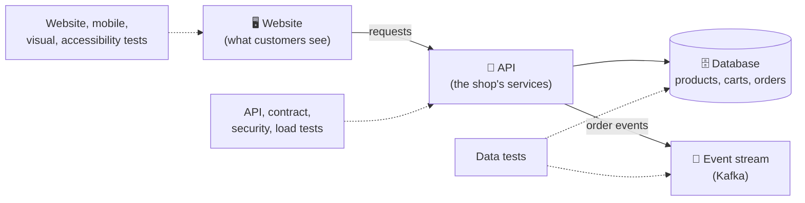
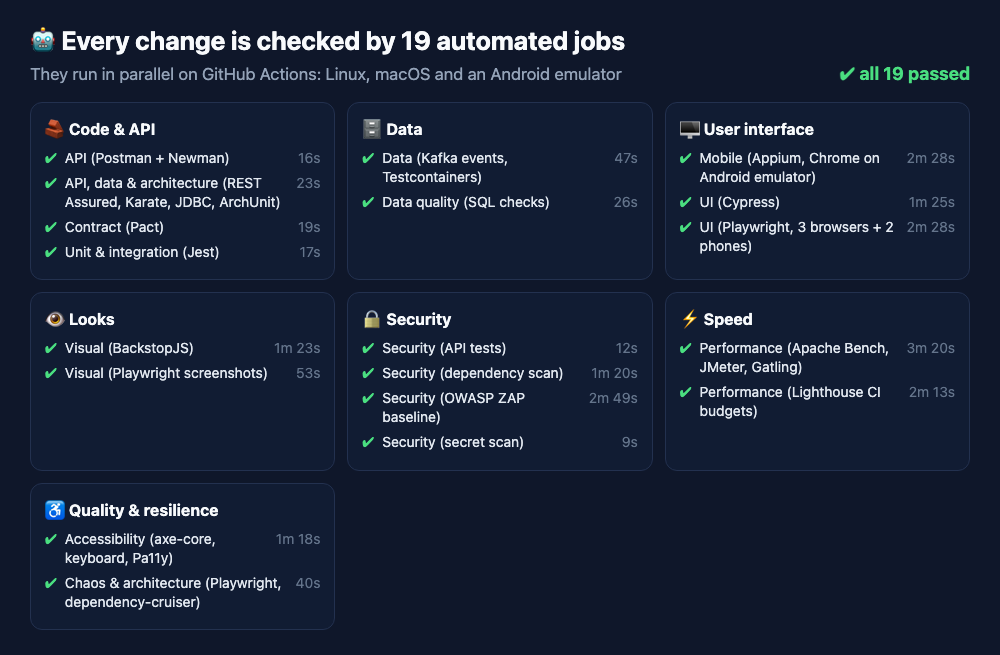

<p align="center">
  
</p>

<p align="center">
  <a href="https://github.com/narek-am/fullstack-test-automation/actions/workflows/ci.yml"></a>
  
  
  
  
  
  
  
  
  
  
  
</p>

## In one minute

Software breaks in many different ways: a button stops working, a page looks wrong on a phone,
a hacker finds a way in, the site slows down under traffic, or one broken service takes everything
down. **Test automation** means writing programs that check for these problems on their own, every
time the code changes, so they are caught before real users see them.

This repository shows that work end to end. I built a small online shop, **ShopLite**, and tested
it from every angle a real product team would care about. Every test runs automatically on each
change.

<table>
  <tr>
    <td align="center" width="25%"><h2>12</h2>kinds of testing</td>
    <td align="center" width="25%"><h2>25+</h2>testing tools</td>
    <td align="center" width="25%"><h2>19</h2>automated checks on every change</td>
    <td align="center" width="25%"><h2>14</h2>real bugs found and fixed</td>
  </tr>
</table>

**Jump to:**
[🖥️ Website](#ui) ·
[📱 Mobile](#mobile) ·
[👁️ Looks](#visual) ·
[🔒 Security](#security) ·
[⚡ Speed](#speed) ·
[♿ Accessibility](#accessibility) ·
[💥 Chaos](#chaos) ·
[🔌 API & data](#api) ·
[🏛️ Architecture](#architecture) ·
[🤖 Automation](#ci) ·
[🐞 Bugs found](#bugs)

---

<a id="ui"></a>

## 🖥️ Website tests: does the shop work?

**In plain words:** a robot uses the shop the way a customer would (logs in, picks a product, pays)
and checks that every step works. It does this in Chrome, Firefox and Safari.


**What's checked**
- Logging in and out, wrong passwords, being sent to the login page when needed
- Searching, filtering and sorting products
- Adding to the cart, changing quantities, the cart total, running out of stock
- Placing an order and seeing it in the order history

<details>
<summary><b>Technical details</b></summary>

- **Playwright** (TypeScript) with page objects and fixtures, in Chromium, Firefox and WebKit: 81 tests. [`e2e/playwright`](e2e/playwright)
- **Cypress** focused on network stubbing: faking slow or failing servers to test the page's reaction. [`e2e/cypress`](e2e/cypress)
- Every test run starts its own copy of the shop with its own database, so tests never interfere.
</details>

---

<a id="mobile"></a>

## 📱 Mobile tests: does it work on phones?

**In plain words:** the same shopping trip on an iPhone and an Android phone: taps instead of
clicks, small screens, the on-screen keyboard and turning the phone sideways.



**What's checked**
- Every page fits the screen, with nothing cut off or scrolling sideways
- Buttons and links are big enough to tap with a finger
- The right keyboard appears (email keyboard, number pad for quantities)
- It still works in landscape, and in the real Chrome browser on an Android device

> [!NOTE]
> **Found and fixed:** the menu links were too small to tap comfortably, and iPhones showed the
> full keyboard instead of the number pad for quantities.

<details>
<summary><b>Technical details</b></summary>

- **Playwright device emulation**: Pixel 7 (Chromium) and iPhone 14 (WebKit) with touch, 34 tests. [`e2e/playwright/mobile`](e2e/playwright/mobile)
- **Appium 3 + WebdriverIO**: the real Chrome on an Android 14 emulator, including the system keyboard and rotation. Runs in CI on every change. [`mobile-tests`](mobile-tests)
</details>

---

<a id="visual"></a>

## 👁️ Visual tests: does it still look right?

**In plain words:** screenshots of every page are compared with approved ones, pixel by pixel.
If a change somewhere in the code makes a page look different, the test shows exactly what moved.



**What's checked**
- 11 pages and states on a phone, a tablet and a desktop screen (29 screenshots)
- Single components: product cards, buttons when hovered, focused or disabled, messages

<details>
<summary><b>Technical details</b></summary>

- **BackstopJS** for whole pages at 3 screen sizes. [`visual-tests/backstop`](visual-tests/backstop)
- **Playwright screenshots** for components and interaction states. [`e2e/playwright/visual`](e2e/playwright/visual)
- Tolerances come from measuring real differences between machines, so tests catch real changes without flaking.
</details>

---

<a id="security"></a>

## 🔒 Security tests: can a hacker get in?

**In plain words:** the tests attack the shop on purpose with the tricks real hackers use, and
every attack has to fail.



**What's checked**
- Tricking the database with malicious search text (SQL injection)
- Guessing passwords, using stolen or expired logins
- Looking at other customers' orders, or changing prices from the browser
- Malicious content in pages (XSS), oversized requests and hidden files
- Known vulnerabilities in third-party libraries, and passwords or keys accidentally committed to the code
- An independent scan of the running site with **OWASP ZAP**, the industry-standard security scanner

> [!NOTE]
> **Found and fixed:** two kinds of unusual input crashed the product search, and the login form
> could put a password in the web address if JavaScript failed to load.

<details>
<summary><b>Technical details</b></summary>

- 219 security tests with Jest and Supertest, mapped to a [STRIDE threat model](docs/threat-model.md). [`security-tests`](security-tests)
- OWASP ZAP baseline scan, npm audit and OSV-Scanner for dependencies, Talisman for secrets in the whole git history.
</details>

---

<a id="speed"></a>

## ⚡ Load and speed tests: is it fast under pressure?

**In plain words:** thousands of requests hit the shop at once, like a sale day, to check it stays
fast and doesn't fail. Separately, Google's Lighthouse audit checks how quickly each page loads.





**What's checked**
- How many requests per second each part of the shop can answer, and how quickly
- 25 shoppers buying for a minute in a row, and a growing crowd of visitors arriving every second
- Page load speed, page weight and layout stability, with limits that fail the build if exceeded

> [!NOTE]
> **Found and fixed:** pages jumped around while loading (the footer moved down as products
> appeared). Fixed so the layout stays still.

<details>
<summary><b>Technical details</b></summary>

- **Apache Bench** for single endpoints, **JMeter** (closed workload) and **Gatling** (open workload) for user journeys, **Lighthouse CI** with performance budgets. [`performance-tests`](performance-tests)
</details>

---

<a id="accessibility"></a>

## ♿ Accessibility tests: can everyone use it?

**In plain words:** many people use websites with only a keyboard, a screen reader or a large zoom.
These tests make sure the whole shop works for them too.



**What's checked**
- A complete purchase with the keyboard only, with a visible focus ring at every step
- Every page against the international accessibility standard (WCAG 2.2 AA)
- Error messages are read out to screen reader users
- Pages still work zoomed to 400%

> [!NOTE]
> **Found and fixed:** a column header in the cart was invisible to screen readers.

<details>
<summary><b>Technical details</b></summary>

- **axe-core** scans and keyboard tests in Playwright, **Pa11y CI** as a second engine, **Lighthouse** accessibility score of 100. [`accessibility-tests`](accessibility-tests)
</details>

---

<a id="chaos"></a>

## 💥 Chaos tests: what if something breaks?

**In plain words:** parts of the shop are switched off or slowed down on purpose, to check that
customers get a clear message instead of a broken page, and that everything recovers afterwards.



**What's checked**
- A service goes down: a clear error, and automatic recovery
- Placing an order fails: the cart is kept, nothing is ordered, and a retry creates exactly one order
- The server restarts: customers are asked to log in again and keep their cart
- Everything is slow: pages still load, and impatient double clicks don't add items twice

> [!NOTE]
> **Found and fixed:** on a slow connection a double click added an item twice, and after a
> server restart customers saw a technical error instead of the login page.

<details>
<summary><b>Technical details</b></summary>

- Playwright experiments with a harness that injects latency and errors or restarts the real server. [`cfr-tests`](cfr-tests)
</details>

---

<a id="api"></a>

## 🔌 API, contract and data tests: the parts you don't see

**In plain words:** behind every web page there are services exchanging data, and a database
storing it. These tests check those hidden parts directly, which is much faster than going
through the website.



**What's checked**
- Every API answer: correct data, correct format, correct error messages
- **Contracts:** the website and the API agree on the data they exchange, so one can't break the other
- **Data quality:** no negative stock, no orders without items, totals that add up
- **Events:** every order publishes exactly one correct message for other systems

<details>
<summary><b>Technical details</b></summary>

- **Postman + Newman** with data-driven login cases. [`api-tests/postman`](api-tests/postman)
- **REST Assured** (Java, JUnit 5, JSON Schema) and **Karate**. [`java-tests`](java-tests)
- **Pact** consumer-driven contracts with provider verification. [`contract-tests`](contract-tests)
- **SQL data-quality checks**, **JDBC** persistence tests, **Kafka** event tests with **Testcontainers**. [`data-tests`](data-tests)
</details>

---

<a id="architecture"></a>

## 🏛️ Architecture tests: is the code well organised?

**In plain words:** good code is split into clear parts that don't tangle together. These tests
check the rules about which part may use which, like building regulations for software.

<details>
<summary><b>Technical details</b></summary>

- **dependency-cruiser** enforces 13 layering rules on the shop's code. [`cfr-tests`](cfr-tests)
- **ArchUnit** enforces rules on the Java test code itself. [`java-tests`](java-tests)
- **Found and fixed:** one part of the API was reaching into another; the shared code was moved to its own module.
</details>

---

<a id="ci"></a>

## 🤖 It all runs by itself

Every time the code changes, 19 automated jobs run all of the above in parallel, on Linux, macOS
and an Android emulator. If anything fails, the change is flagged with the exact reason.



<details>
<summary><b>Technical details</b></summary>

- GitHub Actions workflow: [`.github/workflows/ci.yml`](.github/workflows/ci.yml). Failures from BackstopJS, Playwright, ZAP, Talisman, Lighthouse and Appium are turned into readable annotations on the run page.
- A [`Jenkinsfile`](Jenkinsfile) describes the same stages for Jenkins. It follows the same structure but has not been run on a live Jenkins server.
</details>

---

<a id="bugs"></a>

## 🐞 Bugs the tests caught

Writing these tests found 14 real problems in the shop. Each was fixed, usually with a test that
proves it stays fixed:

| What was wrong | Found by | Fix |
|----------------|----------|-----|
| The cart didn't fit on a phone screen | Visual tests | [`a2096d8`](https://github.com/narek-am/fullstack-test-automation/commit/a2096d8) |
| Dropdowns looked different on each computer | Visual tests | [`dc98c3c`](https://github.com/narek-am/fullstack-test-automation/commit/dc98c3c) |
| Unusual search input crashed the product search | Security tests | [`f6bd96a`](https://github.com/narek-am/fullstack-test-automation/commit/f6bd96a) |
| Product numbers written in odd formats were accepted | Security tests | [`d33bc51`](https://github.com/narek-am/fullstack-test-automation/commit/d33bc51) |
| A password could end up in the web address | Security scan (ZAP) | [`1d0c9c2`](https://github.com/narek-am/fullstack-test-automation/commit/1d0c9c2) |
| A browser security setting was missing | Security scan (ZAP) | [`f70c906`](https://github.com/narek-am/fullstack-test-automation/commit/f70c906) |
| Pages jumped around while loading | Lighthouse | [`23e2e20`](https://github.com/narek-am/fullstack-test-automation/commit/23e2e20) |
| The page shifted sideways on Linux computers | Lighthouse | [`98a5e6b`](https://github.com/narek-am/fullstack-test-automation/commit/98a5e6b) |
| Screen readers couldn't read a cart column | Accessibility tests | [`46e1343`](https://github.com/narek-am/fullstack-test-automation/commit/46e1343) |
| A double click added an item twice | Chaos tests | [`d319b4e`](https://github.com/narek-am/fullstack-test-automation/commit/d319b4e) |
| A server restart showed a technical error | Chaos tests | [`b2f10f5`](https://github.com/narek-am/fullstack-test-automation/commit/b2f10f5) |
| Two parts of the code were tangled together | Architecture tests | [`e023e30`](https://github.com/narek-am/fullstack-test-automation/commit/e023e30) |
| Links were too small to tap on a phone | Mobile tests | [`636b986`](https://github.com/narek-am/fullstack-test-automation/commit/636b986) |
| Phones showed the wrong keyboard for quantities | Mobile tests | [`d45e35e`](https://github.com/narek-am/fullstack-test-automation/commit/d45e35e) |

---

## 🧭 How the tests are built

- **Tests that fail for the right reason.** New suites were checked by breaking the shop on purpose
  (hiding the focus ring, adding delays, inflating the page, adding a forbidden dependency), because
  a test that can't fail proves nothing.
- **Limits from measurements, not guesses.** Screenshot tolerances, speed budgets and load limits
  are based on measured values, written next to each setting.
- **False alarms are investigated, not silenced.** When a tool flagged something harmless, it was
  checked against the standard first and then excluded only where it applies, with the reason.
- **Real output everywhere.** Every GIF on this page is generated by a [script](docs/media/generator)
  from the running shop and real test results.

Planning documents: [test strategy](docs/test-strategy.md) ·
[exploratory testing charters](docs/exploratory-testing.md) · [threat model](docs/threat-model.md)

<details>
<summary><b>▶ Run it yourself</b></summary>

Requirements: Node.js 24. Some suites also need Java 21, Google Chrome, Docker (Kafka tests) or an
Android emulator (Appium).

```bash
cd app && npm ci && npm start        # the shop on http://localhost:3000
```

```bash
cd app && npm test                   # unit and integration tests
```

```bash
cd e2e/playwright && npm ci && npx playwright install && npm test
```

Every other suite runs the same way from its folder; each folder's README has the exact commands.
Test suites start their own copy of the shop, so nothing else needs to be running.
</details>

## About

The range of testing approaches follows *Full Stack Testing* by Gayathri Mohan (O'Reilly). The shop
and all the test code here are my own.
