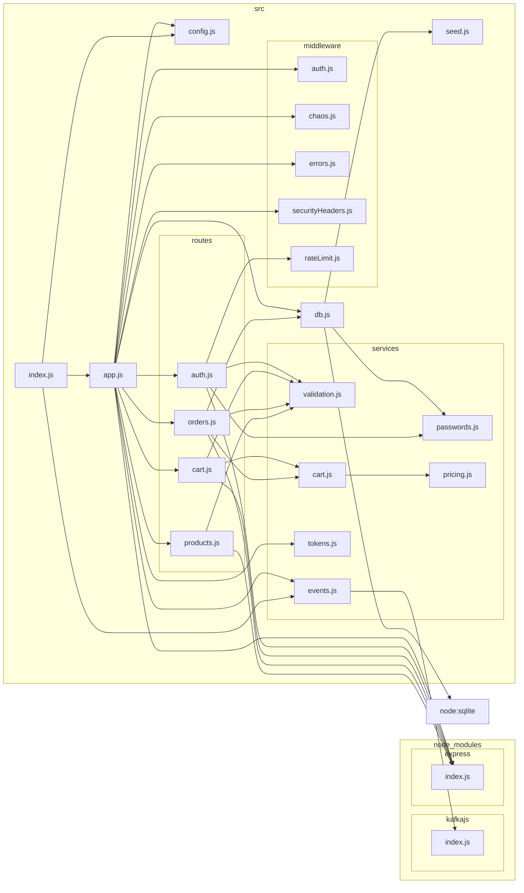

# Cross-functional requirement tests

Tests for qualities that aren't features: does ShopLite **survive failures** (chaos experiments),
and does its code **keep its intended structure** (architecture rules).

| Area | Tool | Where |
|------|------|-------|
| Chaos experiments | Playwright + a server harness that breaks the app | `chaos/` |
| Architecture rules (ShopLite, Node.js) | dependency-cruiser | `architecture/dependency-cruiser.cjs` |
| Architecture rules (Java test project) | ArchUnit | `java-tests/.../architecture/TestSuiteArchitectureTest.java` |

All run in CI: job `cfr` (chaos and dependency-cruiser) and `api-java` (ArchUnit).

```bash
cd app && npm ci && cd ../cfr-tests && npm ci && npx playwright install chromium
npm run architecture   # dependency-cruiser
npm run chaos          # chaos experiments
```

## Chaos experiments

[`support/shoplite.ts`](support/shoplite.ts) starts a real ShopLite process with the opt-in chaos
middleware (`CHAOS_ENABLED=true`), and can inject latency or errors into chosen API paths, or stop
and restart the whole server. The SQLite file survives restarts; sessions, which live in memory, don't.

Every experiment follows the same shape: check the **steady state**, inject **one fault**, check the
**hypothesis** (what the shopper should see), then **roll back** (always, even when it fails) and check
that the shop recovers.

| Experiment | Fault | Hypothesis |
|------------|-------|------------|
| Product API down | 100% `503` on `/api/products` | Error banner instead of a blank page; header still works; recovers on reload |
| Checkout fails | 100% `503` on `/api/orders` | User stays on the cart with an error; cart, stock and orders unchanged; retry creates exactly one order |
| Slow cart API | 1.5 s on `/api/cart` | A double click on "Add to cart" adds the item once |
| Slow API everywhere | 2 s on every `/api/` call | Pages still load, in about one latency period (calls run in parallel) |
| Server restart | Process stopped and started | User is asked to log in again and returns to the cart, which still has the item |

### Bugs found

1. **Double add on a slow connection:** with 1.5 s of latency, a double click put **2** items in the
   cart. "Add to cart" and "Place order" are now disabled while their request runs.
2. **Broken state after a restart:** the next page showed a raw "Invalid or expired token" error,
   while the header still said "Hi, Bob". Now a rejected session sends the user to
   `/login?next=…&expired=1` with "Your session has expired. Please log in again.", and back to the
   same page after logging in. The Cypress session test, which was named for this behaviour but
   only checked the error text, now checks the redirect.

## Architecture rules: ShopLite (dependency-cruiser)

The intended structure of the server: `routes/` handle HTTP, `services/` hold logic that knows
nothing about HTTP, `db.js` is the only module that talks to SQLite. The rules:

| Rule | Why |
|------|-----|
| `routes-are-independent`, `only-app-wires-routes` | One route never reaches into another; routes are mounted in one place |
| `services-know-nothing-about-http-or-storage` | Services can be unit tested without a server; the DB connection is passed in |
| `middleware-does-not-use-routes-or-db` | Middleware stays generic |
| `only-db-talks-to-sqlite` | Connection handling in one module |
| `kafka-stays-optional` | `kafkajs` is optional; only the event publisher may import it |
| `only-entry-points-read-config` | Config is passed down, so tests can override it with `createApp(overrides)` |
| `browser-code-stays-in-the-browser`, `pages-do-not-import-pages` | Front-end code is separate; each page script is an entry point |
| `no-circular`, `no-orphans`, `not-to-unresolvable`, `not-to-dev-dependencies` | General hygiene |

**Found:** the order route imported `loadCart` from the cart route. It moved to `services/cart.js`.
To see the rules fire, add `require('../db')` to `services/pricing.js`: the build fails with the
rule name and the offending import.

Current dependency graph (`npm run architecture:graph`):



## Architecture rules: Java test project (ArchUnit)

Test code is code too. [`TestSuiteArchitectureTest`](../java-tests/src/test/java/com/shoplite/architecture/TestSuiteArchitectureTest.java) checks that:

- the `api`, `karate` and `data` suites don't depend on each other, and `support` knows nothing about them;
- API response models are records and plain data (no REST Assured, JUnit or AssertJ);
- every concrete `*Test` class has a JUnit `@Tag`, so CI can select suites with `-Dgroups=`;
- there is no `Thread.sleep` outside the server harness, no console output and no generic exceptions.
